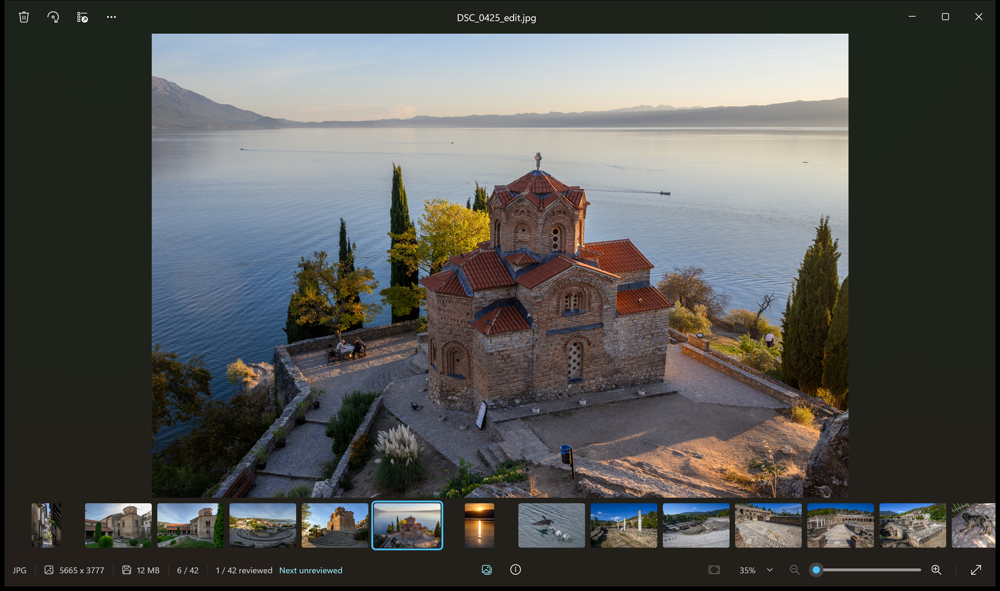

# Flick

A fast photo viewer and culling tool for Windows, made for Nikon NEF, DNG and JPG files. It looks like the Windows Photos viewer, but the next photo is there the moment you press the arrow key, even with raw files.

**Beta:** 0.9 is the first public version, so you may find rough edges. Reports are welcome on the [Issues page](https://github.com/plevko/flick/issues).

## What it does

- **Instant next photo.** NEFs are shown from the full-size JPEG preview the camera stores in every file, so nothing waits for a raw conversion. The photos before and after the current one are prepared in the background. Holding an arrow key keeps up with the key.
- **Culling without a catalog.** Everything happens in the folder itself, so Lightroom, Explorer and other apps see the result:
  - `Space` or `P` picks a photo: it moves into a `_picks` subfolder and stays in the list, marked "✓ Picked".
  - `X` rejects a photo into `_rejected`. At the end, "Delete all" sends the rejects to the Recycle Bin after one confirmation.
  - `1` to `5` set a star rating where Lightroom and Windows read it: in the `.xmp` file next to a NEF, inside the file for DNG and JPG.
  - `R` rotates, saved in the file without re-encoding the photo.
  - `Ctrl+Z` undoes picks, rejects, ratings and rotations.
  - The folder names `_picks`, `_rejected` and `_export` can be changed in Settings.
- **Bursts and the filmstrip.** Photos taken within a second of each other are one stack in the filmstrip. `Ctrl+→` jumps past a burst, and coming back lands on the frame you last looked at.
- **RAW+JPG pairs.** A NEF and a JPG with the same name are one photo. `J` switches between the two files at the same zoom and spot. Picking, rating and rotating apply to both.
- **Where the camera focused.** `Z` shows the focus point recorded in a Nikon NEF, on Z cameras and Live View exactly, on D780 and D5500 viewfinder grids too.
- **Progress per folder.** "312 / 500 reviewed" in the bottom bar, and a "Next unreviewed" link that takes you to the next photo you haven't looked at.
- **Smaller copies for email.** `Ctrl+Shift+S` saves the photo, or all picks, as JPGs under 2 MB that keep the date, camera and colours.
- **Zoom for checking focus.** A click zooms to 200% at that spot, another click goes back. Zoomed in, the arrow keys move to the next photo at the same zoom and spot.
- **Familiar.** The Windows 11 look, a Photos-style info panel, full screen, light and dark themes.
- **Updates itself.** When a new version is out, the bottom bar offers it. One click downloads it, and it installs when you close Flick.

## Download

Get the latest version from the [Releases page](https://github.com/plevko/flick/releases/latest). There are two packages:

- **Installer** (`Flick-Setup-0.9.0.exe`, about 35 MB): installs for your user without admin rights, or for all users if you choose. It can add Flick to "Open with" for NEF, DNG and JPG files. To open photos with Flick on double-click, choose it in **Windows Settings → Apps → Default apps → Flick**.
- **Portable** (`Flick-0.9.0-portable.zip`, about 48 MB): unzip anywhere, a USB stick works, and run `Flick\flick.exe`. Its settings stay in its own folder, and it changes nothing in Windows.

**"Windows protected your PC":** Flick isn't signed with a paid code-signing certificate, so Windows SmartScreen warns about it at first. Click **More info**, then **Run anyway**. Each release lists the SHA-256 checksums of both packages and a VirusTotal scan, so you can check the file you downloaded.

**Requirements:** Windows 10 version 2004 or later, or Windows 11, on a 64-bit PC. Nothing else to install. Windows' RAW Image Extension isn't needed; without it only Explorer's own thumbnails of raw files are missing.

## Keys

| Key | Action |
|---|---|
| `→` `←`, mouse wheel | Next / previous photo |
| `Ctrl+→` / `Ctrl+←` | Next / previous stack in the filmstrip (past a burst) |
| Click | Zoom to 200% at that spot; click again to fit |
| `Ctrl` + wheel | Zoom around the pointer |
| `Space` or `P` | Pick (again: unpick) |
| `X` | Reject (again: move it back) |
| `1` to `5`, `0` | Star rating; `0` clears it |
| `R` / `Shift+R` | Rotate right / left |
| `Del` | Move to the Recycle Bin |
| `Ctrl+Z` | Undo |
| `Z` | Show where the camera focused |
| `J` | Switch between the NEF and JPG of a pair |
| `I` | Info panel |
| `F6` | Filmstrip on / off |
| `F` or `F11`, `Esc` | Full screen, leave full screen |
| `Ctrl+Shift+S` | Save smaller copy |
| `Ctrl+E` | Open with another app |

The mouse wheel can zoom instead, and the click zoom can be 100% or 400%, in **… → Settings**.

## Privacy

- **No account and no telemetry.** Flick works offline.
- **One daily update check.** Once a day Flick asks GitHub for the newest version number. Nothing about you or your photos is sent. Turn it off in **Settings → Check for updates**.
- **Your files change only when you ask.** Picking and rejecting move files into `_picks` and `_rejected`. A rating writes the `.xmp` file next to a NEF, or the rating inside a DNG or JPG. Rotating changes the orientation inside the file, not the photo itself. Deleting uses the Recycle Bin, and on drives without one, such as SD cards, Flick asks first. Saving a smaller copy writes a new file into `_export` and never replaces one.

## Known limitations

- NEFs are shown from the camera's JPEG preview, not a raw conversion: what you see is the camera's own rendering.
- DNGs that only carry a small preview, such as DJI drone files and Lightroom edits, use the camera's JPG of the same name when there is one. Otherwise Flick converts the raw data itself, which looks more neutral than the camera's JPG and doesn't apply Lightroom's edits or crop.
- A GoPro `.gpr` is shown through the JPG of the same name. Without that JPG, Flick lists it and says it can't show it.
- Flick can't undo a delete, but the Recycle Bin can.
- It uses about 1 GB of memory while browsing, to keep the photos around the current one ready.
- Windows on x64 only, for now.

## Feedback

Found a bug or missing something? Open an issue on the [Issues page](https://github.com/plevko/flick/issues). A screenshot and your camera model help.

## Licence

Flick is free to use, at home and at work. You may share unchanged copies, but not sell or modify them. The full licence is `LICENSE.txt`, next to `flick.exe` and in the installer. Flick includes open-source components under their own licences, listed in the `licenses` folder.
